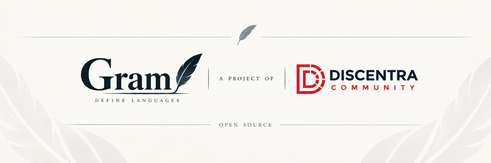

<p align="center">
  
</p>

# Gram Framework

<p align="center">
  <strong>Pure-Python Combinator Parsing & Language Design Toolkit</strong><br>
  Lexer, backtracking parser combinators, Pratt expression parsing, AST construction, and VS Code / LSP tooling.
</p>

<p align="center">
  <a href="https://www.python.org/"></a>
  
  <a href="tests/"></a>
  <a href="LICENSE"></a>
  <a href="https://github.com/GrandKenzy/Gram"></a>
</p>

> [!WARNING]
> **Breaking change in `2.0.0b1`:** `config.ERROR_EXIT_ON_ERROR` now defaults to **`True`**, so unsuppressed errors call `Error.raise_error()` and terminate the process (`sys.exit(1)`). To collect diagnostics without exiting, set `config.ERROR_EXIT_ON_ERROR = False` or register an error hook returning `ErrorAction.SUPPRESS_RAISE` / `ErrorAction.OMIT`. See the [versioned changelog](changelog/README.md) for full details.

---

## Overview

**Gram** is a zero-dependency, pure-Python library for tokenizing source text, defining grammars with composable parser combinators, and building Abstract Syntax Trees (ASTs).

What is actually implemented in the repository:
- **Lexer (`gram.core.lexer`):** Configurable line/multiline tokenizer supporting keywords (`Keyword`), semantic keyword groups (`WordGroup`), custom operator symbols (`MAP_SYMBOLS`, `insert_symbol`, `disabled_symbol`), indentation tracking (`Token.INDENT` / `Token.DEDENT`), strings, docstrings, numbers, and configurable single- or multi-character line comments.
- **Transactional Parser State (`gram.core.parser`):** Token stream cursor (`Parser`, `ParseState`) with immutable `Checkpoint` snapshots (`savepoint` and `restore`) that roll back the cursor, virtual lookahead cursor (`vpos`), bracket depth, `storage` dictionary, `tk_tags` token tags, and in-place token replacements.
- **Combinator Library (`gram.core.combinators`):**
  - **Matching:** `MatchToken`, `MatchKeyword`, `MatchGroup`, `MatchSeqSymbol`, `generador_expr`.
  - **Structural:** `Seq`, `Alt`, `Opt`, `Enclosed`, plus `+` (`Seq`) and `|` (`Alt`) operator overloads.
  - **Repetition & Delimited Lists:** `Many`, `Some`, `Until`, `UntilIndent`, `Separator` (produces `ArrayNode`).
  - **Rules, Atoms & State:** `RuleItem`, `Ref`, `Item`, `Literal`, `Save`, `Load`.
  - **Lookahead, Signals & Tagging:** `Peek`, `Not`, `If`, `Skip` (with `SkipFlowSignal`, `BreakFlowSignal`, `BacktrackSignal`, `CutFlowSignal`, `AbortFlowSignal`), `Tag`, `Tokenize`, `ErrorCombinator`.
  - **Fluent Token Constraints:** `Req` (case, substring, length, numeric bounds, digit counts, and value transformations).
  - **Preprocessing & Expectations:** `Preprocess`, `Convert`, and `Expected` for callback validation, logical identifier conversions, and strict zero-width assertions.
  - **Pratt Expression Engine:** `ArithmeticExpr`, `ConditionalExpr`, and `DualExpr` producing `ASTBinaryOp` and `ASTUnaryOp` nodes.
- **AST & Tracing (`gram.core.ast`):** `ASTAnalyzer` validates the root entrypoint rule (`Alt` of `Ref` branches), evaluates combinators through `Visitor`, and records execution traces in `RayTracing` (`trace="off" | "basic" | "detailed"`).
- **Isolated Language Sessions (`gram.sessions`):** `Session` snapshots, migrates, and restores global `config`, `MAP_KEYWORDS`, `WordGroup` registries, and `MAP_SYMBOLS` so multiple language definitions can coexist in the same process.
- **VS Code & LSP Tooling (`gram.vsix`):** VSIX extension generator (`VSIXGenerator`, `pack_vsix`), AST token coloring (`ASTColorResolver`), and a JSON-RPC Language Server (`LSPServer`, `LSPState`).

---

## Pipeline Architecture

```
Source Text (str | list[str])
      │
      ▼
Lexer(source).process()           ──► list[TokenType]
      │
      ▼
Parser(tokens)                    ──► ParseState + Checkpoint savepoint/restore
      │                               + Hookr ('save' / 'restore' callbacks)
      ▼
ASTAnalyzer(parser, Entrypoint)   ──► Evaluates RuleItem & Combinator tree
      │                               + Diagnostics (failure_scope, error hooks)
      │                               + RayTracing (trace="off"|"basic"|"detailed")
      ▼
list[ASTNode]                     ──► ASTRef, ArrayNode, ASTBinaryOp, ASTUnaryOp,
                                      Identifier, LiteralNumber, LiteralString,
                                      LiteralSymbol, ASTKeyword
```

---

## Installation

Gram is a pure-Python package with zero third-party runtime dependencies (Python 3.10+).

### 1. From Source (Git Checkout)

Clone the repository and add its root directory to `PYTHONPATH` (or work directly inside the repository root):

```bash
git clone https://github.com/GrandKenzy/Gram.git
cd Gram
python -m gram
# Output: Gram Framework v2.0.0b3
```

### 2. With VNMA (Vendor Manager)

Gram includes a [`vnma_config.toml`](vnma_config.toml) manifest exposing the `gram` module and the `gram` CLI entry point (`gram.__main__:main`). Declare Gram in your project's `vnma.toml`:

```toml
[project]
name = "my-compiler"
version = "0.1.0"

[dependencies]
# From GitHub (pinned to the v2.0.0b2 beta tag or tracking main):
gram-framework = { git = "https://github.com/GrandKenzy/Gram.git", tag = "v2.0.0b2" }
# gramv2.0.0b = { git = "https://github.com/GrandKenzy/Gram.git", branch = "main" }

# Or from a local directory for real-time editable changes:
# gram = { path = "~/Desktop/Gram", editable = true }

[tool.vnma]
vendor_dir = "vendor"
ide_integration = ["vscode", "pycharm"]
```

Then run `vnma install` (or `vnma link "~/Desktop/Gram"`). For any questions regarding **VNMA**, refer to its official documentation at **[https://github.com/GrandKenzy/vnma](https://github.com/GrandKenzy/vnma)**.

---

## Quickstart

A root entrypoint rule passed to `ASTAnalyzer` (or `Parser.parse`) must be a `RuleItem` subclass whose `entrypoint` is an `Alt` composed of `Ref(...)` rules. At least one keyword must be registered in `gram.core.lexer.words` before running `Lexer.process()`.

```python
from gram.core.ast import ASTAnalyzer
from gram.core.combinators import (
    Alt,
    ArithmeticExpr,
    MatchKeyword,
    MatchToken,
    Ref,
    RuleItem,
    Seq,
)
from gram.core.lexer import Lexer, Token, words
from gram.core.parser import Parser

# 1. Register keywords in the lexer
words.clear_all()
words.add_keyword("let", hex_color="#569CD6", description="Variable binding")

# 2. Define production rules with RuleItem
class LetStatement(RuleItem):
    # nodeable=True is the default on RuleItem subclasses, so Ref(LetStatement)
    # wraps matched children in ASTRef(name="LetStatement", nodes=[...]).
    entrypoint = Seq(
        MatchKeyword("let"),
        MatchToken(Token.IDENT),
        MatchToken(Token.ASSIGN),
        ArithmeticExpr(Token.NUMBER, Token.IDENT),
        MatchToken(Token.SEMICOLON),
    )

# 3. Root entrypoint rule: must be an Alt(...) of Ref(...) branches
class Program(RuleItem):
    entrypoint = Alt(Ref(LetStatement))

# 4. Tokenize source code
source = "let total = 10 + 20 * 3;"
tokens = Lexer(source).process()

# 5. Parse and analyze (with detailed raytracing enabled)
parser = Parser(tokens)
analyzer = ASTAnalyzer(parser, Program, mode="Many", trace="detailed")
nodes = analyzer.process()

print("AST roots:", nodes)
stmt = nodes[0]
print("Statement name:", stmt.name)
print("Identifier:", stmt.nodes[1].token.value)
print("Expression:", stmt.nodes[3])
print("\nDetailed trace:\n" + analyzer.raytracing.detailed())
```

Output:

```text
AST roots: [AstRef(nodes=5, name=LetStatement)]
Statement name: LetStatement
Identifier: total
Expression: ASTBinaryOp(left=NUMBER, op=PLUS, right=ASTBinaryOp(left=NUMBER, op=STAR, right=NUMBER))

Detailed trace:
PROGRAM
    ->Ref(LetStatement) [0:9] SUCCESS
        ->Seq [0:9] SUCCESS
            ->MatchKeyword [0:1] SUCCESS
            ->MatchToken [1:2] SUCCESS
            ->MatchToken [2:3] SUCCESS
            ->ArithmeticExpr [3:8] SUCCESS
            ->MatchToken [8:9] SUCCESS
```

---

## Core Subsystems Reference

| Subsystem | Module | Key Classes & Functions |
| :--- | :--- | :--- |
| **Configuration** | [`gram.config`](gram/config.py) | `ERROR_EXIT_ON_ERROR`, `ERROR_HIDE_CONSOLE`, `LOG_HIDE_CONSOLE`, `INFO_INIT`, `INFO_GENERATE_LOGFILE`, `INFO_GENERATE_LOGFILE_ON_ERROR`, `save()`, `load()`, `reset_to_defaults()`, `to_dict()` |
| **Lexer** | [`gram.core.lexer`](gram/core/lexer/__init__.py) | `Lexer`, `Token`, `TokenType`, `CustomToken`, `MAP_SYMBOLS`, `insert_symbol()`, `disabled_symbol()`, `words.add_keyword()`, `words.add_group()` |
| **Parser & Checkpoints** | [`gram.core.parser`](gram/core/parser/__init__.py) | `Parser`, `ParseState`, `Checkpoint`, `TokenInfo`, `Hookr` (`'save'` and `'restore'` checkpoint hooks) |
| **AST & RayTracing** | [`gram.core.ast`](gram/core/ast/__init__.py) | `ASTAnalyzer`, `ASTNode`, `ASTTokenNode`, `Identifier`, `LiteralNumber`, `LiteralString`, `LiteralSymbol`, `ASTKeyword`, `ASTRef`, `ArrayNode`, `RayTracing`, `Trace`, `TraceRecord` |
| **Combinators** | [`gram.core.combinators`](gram/core/combinators/__init__.py) | `Seq`, `Alt`, `Opt`, `Enclosed`, `Many`, `Some`, `Until`, `UntilIndent`, `Separator`, `Ref`, `RuleItem`, `Item`, `Literal`, `Save`, `Load`, `Peek`, `Not`, `If`, `Skip`, `Tag`, `Tokenize`, `ErrorCombinator`, `Req`, `ArithmeticExpr`, `ConditionalExpr`, `DualExpr` |
| **Diagnostics & Hooks** | [`gram.utilities`](gram/utilities/__init__.py) | `Diagnostics`, `ErrorAction` (`OMIT`, `SUPPRESS_RAISE`), `Diagnostics.hook_errors()`, `Diagnostics.failure_scope()` |
| **Sessions** | [`gram.sessions`](gram/sessions/__init__.py) | `Session` (`init()`, `migrate()`, `load()`, `tokenize()`, `parse()`) |
| **VSIX & LSP (Beta)** | [`gram.vsix`](gram/vsix/__init__.py) | `VSIXGenerator`, `VSIXAnalyzer`, `ASTColorResolver`, `LSPServer`, `LSPState`, `pack_vsix()`, `up()` |

---

## Documentation

Full documentation is available in English and Spanish:
- **[English Documentation](docs/en/index.md)**
- **[Documentación en Español](docs/es/index.md)**

Detailed section map:
- **01. Introduction / Introducción:** [EN](docs/en/01-Introduction/index.md) | [ES](docs/es/01-Introduccion/index.md)
- **02. Combinators / Combinadores:** [EN](docs/en/02-Combinators/index.md) | [ES](docs/es/02-Combinadores/index.md)
- **03. Usage Guide / Guía de Uso:** [EN](docs/en/03-Usage/index.md) | [ES](docs/es/03-Uso/index.md)

---

## Running the Test Suite

Run the full test suite using Python's built-in `unittest` discovery:

```bash
python -m unittest discover -s tests
```

```text
----------------------------------------------------------------------
Ran 185 tests in 8.6s

OK
```

---

## Community & Contact

- Contact: **[kencv3002003@gmail.com](mailto:kencv3002003@gmail.com)**
- Issues, bug reports, and pull requests are welcome on [GitHub](https://github.com/GrandKenzy/Gram).

---

## License

Gram is distributed under the **Free Use & Commercial Output License** (see [LICENSE](LICENSE)).

- **Free of Charge:** You may use Gram for personal, educational, research, and commercial projects.
- **Commercial Output Allowed:** Languages, parsers, compilers, and tools built with Gram belong to their creators and may be distributed or commercialized without royalties.
- **Core Immutability:** Gram core may not be modified for downstream redistribution; extensions and grammar definitions should be authored as external modules.
- **No Standalone Resale:** The framework itself may not be rebranded, sublicensed, or sold as a standalone library.

---

<p align="center">
  
</p>
